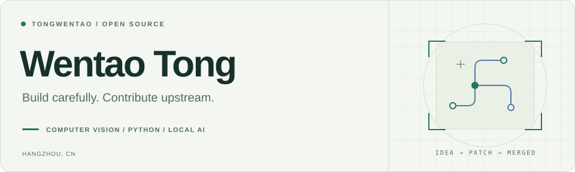

<picture>
  <source media="(prefers-color-scheme: dark)" srcset="assets/header-dark.svg">
  
</picture>

<picture>
  <source media="(prefers-color-scheme: dark)" srcset="assets/metrics-dark.svg">
  
</picture>

I engineer robust software for **computer vision**, **annotation workflows**, and **Python infrastructure**. My open-source work focuses on execution performance, memory safety, and regression tests that protect production toolchains.

Graduate student in Software Engineering & Artificial Intelligence at **Zhejiang University of Science and Technology**, Hangzhou.

[⚡ Merged PRs (40)](https://github.com/search?q=author%3Atongwentao+is%3Apr+is%3Amerged&type=pullrequests) · [📦 Personal Projects](https://github.com/tongwentao?tab=repositories) · [📜 Contribution Audit](https://github.com/search?q=author%3Atongwentao+is%3Apr&type=pullrequests)

---

## 🏛️ Engineering Pillars & Accepted Upstream

My upstream contributions are concentrated around three core engineering disciplines:

### 1. Computer Vision & Annotation Workflows
Foundational tooling for dataset synthesis, image labeling UX, and detection pipelines:

| Project & Impact | Selected Contributions |
| :--- | :--- |
| **[Labelme](https://github.com/wkentaro/labelme)** `16.3k ★` · **12 Merged PRs** | • **Formats & Features**: Added Pillow JPEG 2000 support ([#2833](https://github.com/wkentaro/labelme/pull/2833)), 3-point circumference circle drawing ([#2788](https://github.com/wkentaro/labelme/pull/2788)), double-click shape label editing ([#2744](https://github.com/wkentaro/labelme/pull/2744)), and click-aware canvas menus ([#2745](https://github.com/wkentaro/labelme/pull/2745)). • **Performance & IO**: Eliminated full-image array copying & hashing during display load ([#2741](https://github.com/wkentaro/labelme/pull/2741)), and added pre-decode size bounds to reject oversized payloads ([#2750](https://github.com/wkentaro/labelme/pull/2750)). • **Storage & Path Safety**: Preserved POSIX file mode bits during atomic saves ([#2747](https://github.com/wkentaro/labelme/pull/2747), [#2819](https://github.com/wkentaro/labelme/pull/2819)), and fixed cross-volume Windows UNC path resolution ([#2746](https://github.com/wkentaro/labelme/pull/2746)). |
| **[Supervision](https://github.com/roboflow/supervision)** `51.6k ★` · **2 Merged PRs** | • **Dataset Pipeline**: Enabled loading YOLO segmentation datasets with compact mask representations ([#2834](https://github.com/roboflow/supervision/pull/2834)). • **Export Safety**: Enforced immediate exception propagation on image disk write failures during dataset export ([#2772](https://github.com/roboflow/supervision/pull/2772)). |
| **[SAHI](https://github.com/obss/sahi)** `5.6k ★` · **2 Merged PRs** | • **Inference Slicing**: Preserved hierarchical directory structure and stem names across sliced YOLO label outputs ([#1480](https://github.com/obss/sahi/pull/1480)). • **Dataset Subsampling**: Fixed zero-indexed category mapping during COCO slice extraction ([#1479](https://github.com/obss/sahi/pull/1479)). |
| **[Kornia](https://github.com/kornia/kornia)** `12.4k ★` · **3 Merged PRs** | • **Color Transforms**: Supported integer-valued custom colormap bases while maintaining float precision ([#6172](https://github.com/kornia/kornia/pull/6172)). • **Diagnostic Errors**: Delivered explicit, actionable errors for unsupported Dissolving versions ([#6202](https://github.com/kornia/kornia/pull/6202)) and VisualPrompter layouts ([#6211](https://github.com/kornia/kornia/pull/6211)). |

### 2. High-Performance Image I/O & Memory Safety
Low-level data loading, zero-copy buffers, and binary protocol resilience:

| Project & Impact | Selected Contributions |
| :--- | :--- |
| **[Pillow](https://github.com/python-pillow/Pillow)** `12k+ ★` | • **Buffer Mutability**: Investigated unsafe memory writes on read-only image buffers in `frombytes` and `ImageCms` ([#10256](https://github.com/python-pillow/Pillow/pull/10256)). The `_ensure_mutable()` defensive copy pattern was praised and adapted by core maintainer Andrew Murray in [#10351](https://github.com/python-pillow/Pillow/pull/10351). |
| **[Trimesh](https://github.com/mikedh/trimesh)** `3.7k ★` · **1 Merged PR** | • **3D Parsing**: Hardened point cloud XYZ loaders against arbitrary delimiter column counting and trailing newline-free inputs ([#2635](https://github.com/mikedh/trimesh/pull/2635)). |
| **[fsspec](https://github.com/fsspec/filesystem_spec)** `1.4k ★` · **2 Merged PRs** | • **Filesystem Compatibility**: Supported standard binary update-mode aliases in `MemoryFileSystem` ([#2347](https://github.com/fsspec/filesystem_spec/pull/2347)) and corrected foreground process flags in FUSE CLI ([#2352](https://github.com/fsspec/filesystem_spec/pull/2352)). |

### 3. Core Developer Tooling & Test Infrastructure
Hardening testing frameworks, type safety, and CLI utilities for large-scale codebases:

| Project & Impact | Selected Contributions |
| :--- | :--- |
| **[pytest-dev/iniconfig](https://github.com/pytest-dev/iniconfig)** | • **Typing Precision**: Corrected `.get()` overload resolution for callable positional defaults in pytest's configuration engine ([#87](https://github.com/pytest-dev/iniconfig/pull/87)). |
| **[tox-dev/platformdirs](https://github.com/tox-dev/platformdirs)** | • **Environment Resilience**: Prevented hard failures in headless or isolated CI runners when home directories are undefined ([#638](https://github.com/tox-dev/platformdirs/pull/638)). |
| **[tox-dev/filelock](https://github.com/tox-dev/filelock)** | • **Concurrency**: Documented and verified non-blocking acquisition probes with `blocking=False` ([#873](https://github.com/tox-dev/filelock/pull/873)). |
| **[Pydantic](https://github.com/pydantic/pydantic)** `29.5k ★` | • **API Documentation**: Unified serialization docstrings across `TypeAdapter` method signatures ([#14037](https://github.com/pydantic/pydantic/pull/14037)). |
| **[Datumaro](https://github.com/open-edge-platform/datumaro)** | • **CLI UX**: Added pre-import diagnostics to identify missing optional dependencies before command invocation ([#2223](https://github.com/open-edge-platform/datumaro/pull/2223)). |

*Also accepted into [Mistune](https://github.com/lepture/mistune/pull/516) (3.1k ★), [python-humanize](https://github.com/python-humanize/humanize/pull/469), [python-utils](https://github.com/wolph/python-utils/pull/64), [petl](https://github.com/petl-developers/petl/pull/764) (1.3k ★), [python-ulid](https://github.com/mdomke/python-ulid/pull/68), [cacheout](https://github.com/dgilland/cacheout/pull/49), [click-repl](https://github.com/click-contrib/click-repl/pull/144), [Bracex](https://github.com/facelessuser/bracex/pull/52), [Unbagged](https://github.com/jdmacleod/unbagged/pull/143), [pandora](https://github.com/npechl/pandora/pull/122), [hardcover-mcp](https://github.com/kristianedlund/hardcover-mcp/pull/95), [smart-house-research-toolkit](https://github.com/jddrtn/smart-house-research-toolkit/pull/24), and [CatGPT-Gateway](https://github.com/GautamVhavle/CatGPT-Gateway/pull/20).*

---

## 🤝 Upstream Collaboration & Maintainer Endorsements

In several complex subsystems, preliminary prototypes and edge-case mappings directly unblocked foundational architectural solutions shipped by project maintainers:

> ### ❝ Thanks @tongwentao. This work continues in a stack built on it: #3047 splits the Label List... and #3048 ports this PR's removal flow onto Annotations with your tests and translations. ❞
> **Kentaro Wada ([@wkentaro](https://github.com/wkentaro))** · Author of [Labelme](https://github.com/wkentaro/labelme)
> *On [Labelme #2787](https://github.com/wkentaro/labelme/pull/2787) (Unused label management)*
>
> *(Also cited as the core reference for shape locking in [#2755](https://github.com/wkentaro/labelme/pull/2755), image repair in [#2964](https://github.com/wkentaro/labelme/pull/2964), and translation schema guards in [#3042](https://github.com/wkentaro/labelme/pull/3042))*

> ### ❝ I think that `_ensure_mutable()` should work for this situation though, so I've created #10351. ❞
> **Andrew Murray ([@radarhere](https://github.com/radarhere))** · Core Maintainer of [Pillow](https://github.com/python-pillow/Pillow)
> *Referencing [Pillow #10256](https://github.com/python-pillow/Pillow/pull/10256) (Read-only image buffer mutation guards)*

> ### ❝ Thank you for the pull request. The tests that check nothing is consumed are a nice touch... ❞
> **Rick van Hattem ([@wolph](https://github.com/wolph))** · Author of [python-utils](https://github.com/wolph/python-utils)
> *On [python-utils #62](https://github.com/wolph/python-utils/pull/62), directly guiding the accepted two-step deprecation cycle merged in [#64](https://github.com/wolph/python-utils/pull/64)*

---

<strong>🔍 Audit all 40 merged upstream contributions across 24 repositories</strong>

| Repository | Accepted Pull Request |
| :--- | :--- |
| roboflow/supervision | [#2834 · feat(dataset): load YOLO segmentation datasets with compact masks](https://github.com/roboflow/supervision/pull/2834) |
| roboflow/supervision | [#2772 · fix(dataset): raise when an image cannot be written during export](https://github.com/roboflow/supervision/pull/2772) |
| wkentaro/labelme | [#2833 · feat: support JPEG 2000 images through Pillow](https://github.com/wkentaro/labelme/pull/2833) |
| wkentaro/labelme | [#2819 · test: cover atomic-save directory permissions](https://github.com/wkentaro/labelme/pull/2819) |
| wkentaro/labelme | [#2818 · test(settings): verify keep-previous toggles survive restart](https://github.com/wkentaro/labelme/pull/2818) |
| wkentaro/labelme | [#2817 · test(canvas): cover linestrip phantom edges through real interaction](https://github.com/wkentaro/labelme/pull/2817) |
| wkentaro/labelme | [#2788 · feat: support drawing circles through three circumference points](https://github.com/wkentaro/labelme/pull/2788) |
| wkentaro/labelme | [#2750 · perf(io): bail out on oversized images before decoding](https://github.com/wkentaro/labelme/pull/2750) |
| wkentaro/labelme | [#2748 · chore: drop dead twine dev pin in pyproject.toml (closes #2489)](https://github.com/wkentaro/labelme/pull/2748) |
| wkentaro/labelme | [#2747 · fix(config): preserve existing POSIX mode bits during atomic saves](https://github.com/wkentaro/labelme/pull/2747) |
| wkentaro/labelme | [#2746 · test(app): cover real Windows UNC cross-volume path fallback](https://github.com/wkentaro/labelme/pull/2746) |
| wkentaro/labelme | [#2745 · feat(canvas): choose shape or canvas context menus by click location](https://github.com/wkentaro/labelme/pull/2745) |
| wkentaro/labelme | [#2744 · feat(canvas): double-click shape to edit label (closes #2190)](https://github.com/wkentaro/labelme/pull/2744) |
| wkentaro/labelme | [#2741 · perf(canvas): avoid full image array copy and hashing in load_pixmap](https://github.com/wkentaro/labelme/pull/2741) |
| kornia/kornia | [#6211 · fix(contrib): explain unsupported VisualPrompter configurations](https://github.com/kornia/kornia/pull/6211) |
| kornia/kornia | [#6202 · fix(filters): explain unsupported dissolving versions](https://github.com/kornia/kornia/pull/6202) |
| kornia/kornia | [#6172 · fix(color): accept integer-valued custom colormap bases](https://github.com/kornia/kornia/pull/6172) |
| obss/sahi | [#1480 · Preserve directory and stem names in YOLO label paths](https://github.com/obss/sahi/pull/1480) |
| obss/sahi | [#1479 · Fix category-zero filtering in COCO subsampling](https://github.com/obss/sahi/pull/1479) |
| mikedh/trimesh | [#2635 · Fix XYZ delimiter column counting and newline-free input](https://github.com/mikedh/trimesh/pull/2635) |
| pydantic/pydantic | [#14037 · Unify `TypeAdapter` serialization methods docstrings](https://github.com/pydantic/pydantic/pull/14037) |
| fsspec/filesystem_spec | [#2352 · Fix the FUSE CLI foreground option](https://github.com/fsspec/filesystem_spec/pull/2352) |
| fsspec/filesystem_spec | [#2347 · Accept standard binary update mode aliases in MemoryFileSystem.open](https://github.com/fsspec/filesystem_spec/pull/2347) |
| open-edge-platform/datumaro | [#2223 · fix(cli): explain missing optional dependencies before loading commands](https://github.com/open-edge-platform/datumaro/pull/2223) |
| pytest-dev/iniconfig | [#87 · Fix get overloads for callable positional defaults](https://github.com/pytest-dev/iniconfig/pull/87) |
| tox-dev/platformdirs | [#638 · 🐛 fix(cli): keep reporting when home is unknown](https://github.com/tox-dev/platformdirs/pull/638) |
| tox-dev/filelock | [#873 · 📝 docs(how-to): probe with blocking=False](https://github.com/tox-dev/filelock/pull/873) |
| lepture/mistune | [#516 · docs: handle fence metadata in the highlighting example](https://github.com/lepture/mistune/pull/516) |
| python-humanize/humanize | [#469 · Docs: clarify metric prefix selection examples](https://github.com/python-humanize/humanize/pull/469) |
| petl-developers/petl | [#764 · Refresh OpenRefine's name and links in related work](https://github.com/petl-developers/petl/pull/764) |
| mdomke/python-ulid | [#68 · fix: print results when running ulid as a module](https://github.com/mdomke/python-ulid/pull/68) |
| dgilland/cacheout | [#49 · Preserve memoized function signatures during type checking](https://github.com/dgilland/cacheout/pull/49) |
| click-contrib/click-repl | [#144 · fix: display docstring-derived help in command completions](https://github.com/click-contrib/click-repl/pull/144) |
| wolph/python-utils | [#64 · fix: deprecate nonpositive batch sizes before 5.0](https://github.com/wolph/python-utils/pull/64) |
| facelessuser/bracex | [#52 · fix: include current documentation build inputs in sdist](https://github.com/facelessuser/bracex/pull/52) |
| jdmacleod/unbagged | [#143 · feat(samples): generate a complete Albertsons sample upload](https://github.com/jdmacleod/unbagged/pull/143) |
| npechl/pandora | [#122 · docs: map starting points for new contributors](https://github.com/npechl/pandora/pull/122) |
| kristianedlund/hardcover-mcp | [#95 · docs: document Claude Code setup and current tool capabilities](https://github.com/kristianedlund/hardcover-mcp/pull/95) |
| jddrtn/smart-house-research-toolkit | [#24 · docs: add a dataset catalogue example](https://github.com/jddrtn/smart-house-research-toolkit/pull/24) |
| GautamVhavle/CatGPT-Gateway | [#20 · feat: add multi-tab concurrency, persistent sessions with history deduplication, and SSE streaming](https://github.com/GautamVhavle/CatGPT-Gateway/pull/20) |

Live telemetry snapshot: November 17, 2026. Metrics account for accepted upstream pull requests across independent third-party projects. Tier-1 classification refers to projects with over 10,000 GitHub stars (Supervision 51.6k, Pydantic 29.5k, Labelme 16.3k, Kornia 12.4k). Combined stars exceed 120,000 across all 24 recipient repositories.

---

## 🛠️ Personal Projects

| Project | Overview & Architecture |
| :--- | :--- |
| **[WebLLM Pro](https://github.com/tongwentao/Web_LLM)** | Zero-server in-browser inference powered by **WebGPU** and WebLLM. Features local client-side model caching, persistent multi-session memory, and streaming Markdown parsing. |
| **[Codeforces Analytics](https://github.com/tongwentao/codeforces-analytics-extension)** | **Manifest V3** competitive programming analytics extension with interactive tag heatmaps, rating trend decomposition, and vector chart export. *Archived.* |

---

## 🧰 Engineering Toolkit

- **Vision & Data Systems**: Python · PyTorch · NumPy · OpenCV · Pillow · Qt / PyQt / PySide · Trimesh
- **Browser & Local Inference**: JavaScript · WebGPU · WebLLM · Manifest V3
- **DevOps & Quality Assurance**: pytest · tox · GitHub Actions CI/CD · Git Internals
