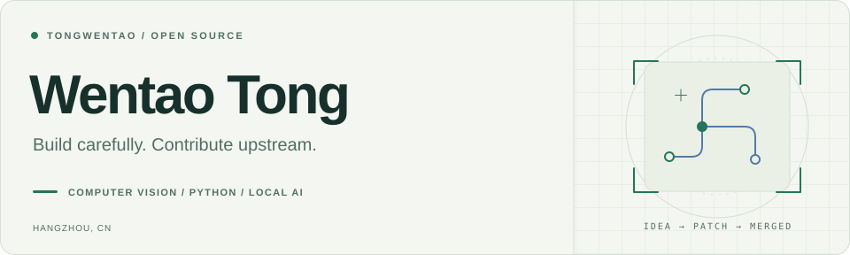

<picture>
  <source media="(prefers-color-scheme: dark)" srcset="assets/header-dark.svg">
  
</picture>

I build practical AI tools and contribute focused fixes to open source.

My interests span **computer vision**, **local inference**, and **developer tooling**.

Software Engineering & Artificial Intelligence · Zhejiang University of Science and Technology · Hangzhou

[Explore my projects](https://github.com/tongwentao?tab=repositories) · [View my pull requests](https://github.com/search?q=author%3Atongwentao+is%3Apr&type=pullrequests)

## Merged contributions

Selected work accepted upstream, spanning performance, annotation workflows, and regression testing.

### [Labelme](https://github.com/wkentaro/labelme)

- **Image loading & AI caching** — [Avoid full-image copying and hashing during loading](https://github.com/wkentaro/labelme/pull/2741), while preserving embedding reuse when revisiting unchanged images.
- **Large-image handling** — [Reject images that exceed Qt's decoding limits before decoding pixels](https://github.com/wkentaro/labelme/pull/2750), avoiding unnecessary work and memory use.
- **Annotation workflow** — [Double-click a shape to edit its label](https://github.com/wkentaro/labelme/pull/2744), with coverage for selection and overlapping shapes.
- **Interaction testing** — [Exercise linestrip hover and point insertion through real Qt events](https://github.com/wkentaro/labelme/pull/2817), guarding against insertion on an invisible closing edge.
- **Development dependencies** — [Remove an unused Twine dependency and its transitive packages](https://github.com/wkentaro/labelme/pull/2748).

### Other projects

| Project | Contribution |
| :--- | :--- |
| **[Kornia](https://github.com/kornia/kornia)** | [Support integer-valued custom colormaps](https://github.com/kornia/kornia/pull/6172), preserving the default floating dtype and explicit dtype overrides. |
| **[CatGPT-Gateway](https://github.com/GautamVhavle/CatGPT-Gateway)** | [Add concurrent browser tabs, persistent sessions, and SSE streaming](https://github.com/GautamVhavle/CatGPT-Gateway/pull/20). |

[View all merged pull requests](https://github.com/search?q=author%3Atongwentao+is%3Apr+is%3Amerged&type=pullrequests)

## Selected projects

| Project | What it does |
| :--- | :--- |
| **[WebLLM Pro](https://github.com/tongwentao/Web_LLM)** | A browser interface for local LLM inference with WebGPU, model caching, and persistent conversations. |
| **[Codeforces Analytics](https://github.com/tongwentao/codeforces-analytics-extension)** | A browser extension for visualizing competitive-programming activity and exporting analytics. *Archived.* |

## Toolkit

**Python** · PyTorch · NumPy · **JavaScript** · WebGPU · Qt · Git
